# Formula

**A CAD-style workbench for formulas you can watch, drag and take apart.** 39 live, interactive
formulas, from polar coordinates to the Lorenz attractor, sorting algorithms, pathfinding and
proofs, each one a resizable viewport on an infinite drafting canvas. Every formula ships with
its reference docs, step-by-step derivations, and working **Python**, **TypeScript** and
**Rust** code. Written in Rust on [egui](https://github.com/emilk/egui)/eframe; runs natively and
in the browser (WebAssembly).

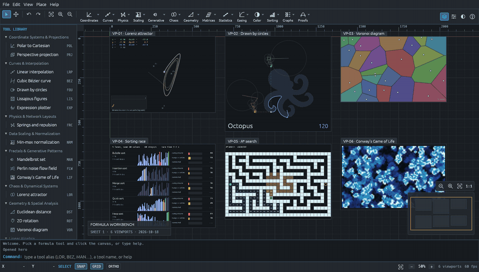

[Showcase](#showcase) · [Gallery](#gallery) · [The workbench](#the-workbench) ·
[Sheet files](#sheet-files) · [Run](#run) · [Develop](#develop)

## Highlights

- **Live viewports on an infinite canvas.** Place any formula with a click (or drag out its size),
  then move, resize, duplicate, lock, hide and undo, with snapping and smart guides, like a CAD
  drawing. Every viewport keeps animating, at any zoom.
- **Hands on.** Drag points, paint cells, draw walls, orbit 3D views, scrub through every step of
  an algorithm like a video.
- **The Inspector explains it.** Each formula's equations and controls, its full reference
  documentation, a **Derive** tab that works the equations out with the viewport's own numbers one
  operation at a time, and code to copy or download.
- **Export.** Python (numpy + matplotlib), TypeScript and Rust (macroquad) programs, **LaTeX** with
  the current parameter values, and a ready-to-run **Jupyter notebook**.
- **Sheets.** Save the whole board, with every formula's settings, as a plain-text `.fwb` file.
- **Native and web.** In the browser, `index.html#mandelbrot` links straight to a formula.

## Showcase

<table>
<tr>
<td width="50%" valign="top"><a href="assets/content/fourier-epicycles/doc.md">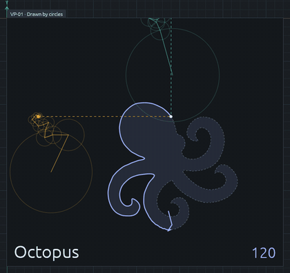</a><br><b>Drawn by circles.</b> Up to 200 spinning circles (a Fourier series) trace one of 64 animal outlines.</td>
<td width="50%" valign="top"><a href="assets/content/lorenz/doc.md">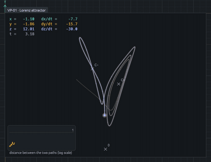</a><br><b>Lorenz attractor.</b> Two paths that start 0.00001 apart, and a log plot of how fast they part.</td>
</tr>
<tr>
<td width="50%" valign="top"><a href="assets/content/sorting-race/doc.md">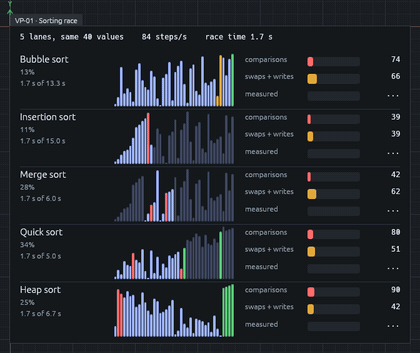</a><br><b>Sorting race.</b> Five algorithms on the same list at the same steps per second.</td>
<td width="50%" valign="top"><a href="assets/content/a-star/doc.md">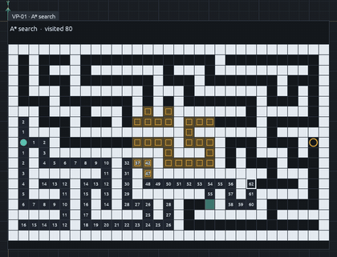</a><br><b>A* search.</b> The frontier, the visited cells and the path, on a maze from the Pathfinding lab sheet.</td>
</tr>
<tr>
<td width="50%" valign="top"><a href="assets/content/pythagorean-proof/doc.md">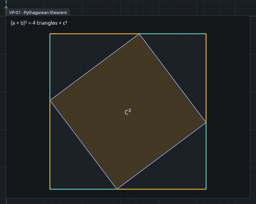</a><br><b>Pythagorean theorem.</b> Four triangles slide around an (a + b)² square, turning c² into a² + b².</td>
<td width="50%" valign="top"><a href="assets/content/game-of-life/doc.md">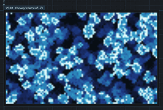</a><br><b>Conway's Game of Life.</b> Draw cells and watch them live, with fading trails of the dead.</td>
</tr>
</table>

## Gallery

Every formula in the tool library, in its order. Click a picture for the formula's reference doc;
the links under it open the example program in each language. Type the three-letter alias on the
command line to place it.

### Coordinate Systems & Projections

<table>
<tr>
<td width="33%" valign="top"><a href="assets/content/polar-to-cartesian/doc.md">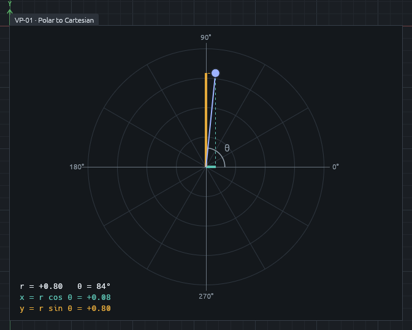</a><br><b>Polar to Cartesian</b> <code>POL</code><br><code>x = r cos θ, y = r sin θ</code><br><sub>Drag the point, or switch to the rose curve r = cos kθ and watch it draw petals.</sub><br><sub><a href="assets/content/polar-to-cartesian/doc.md">Docs</a> · <a href="assets/content/polar-to-cartesian/main.py">Python</a> · <a href="assets/content/polar-to-cartesian/main.ts">TypeScript</a> · <a href="assets/content/polar-to-cartesian/main.rs">Rust</a></sub></td>
<td width="33%" valign="top"><a href="assets/content/perspective-projection/doc.md">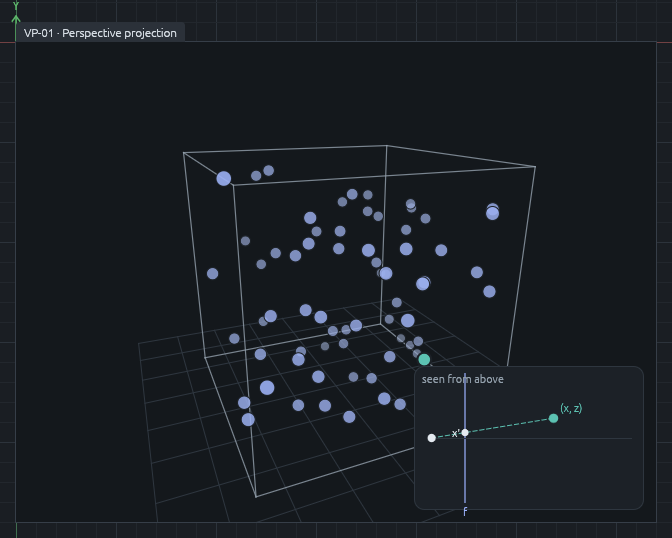</a><br><b>Perspective projection</b> <code>PRJ</code><br><code>x&#x27; = f·x/z + cx</code><br><sub>Drag to orbit a 3D scatter plot; the inset shows one ray from above. Try the dolly zoom.</sub><br><sub><a href="assets/content/perspective-projection/doc.md">Docs</a> · <a href="assets/content/perspective-projection/main.py">Python</a> · <a href="assets/content/perspective-projection/main.ts">TypeScript</a> · <a href="assets/content/perspective-projection/main.rs">Rust</a></sub></td>
</tr>
</table>

### Curves & Interpolation

<table>
<tr>
<td width="33%" valign="top"><a href="assets/content/lerp/doc.md">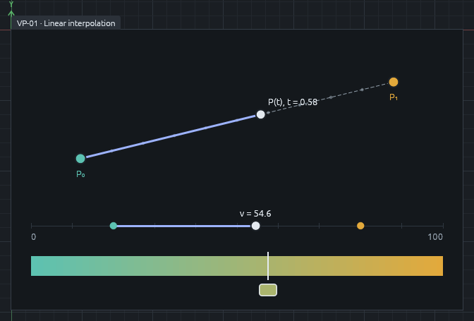</a><br><b>Linear interpolation</b> <code>LRP</code><br><code>v(t) = v0 + t(v1 − v0)</code><br><sub>Drag the endpoints; blend positions, plain numbers and colors.</sub><br><sub><a href="assets/content/lerp/doc.md">Docs</a> · <a href="assets/content/lerp/main.py">Python</a> · <a href="assets/content/lerp/main.ts">TypeScript</a> · <a href="assets/content/lerp/main.rs">Rust</a></sub></td>
<td width="33%" valign="top"><a href="assets/content/cubic-bezier/doc.md">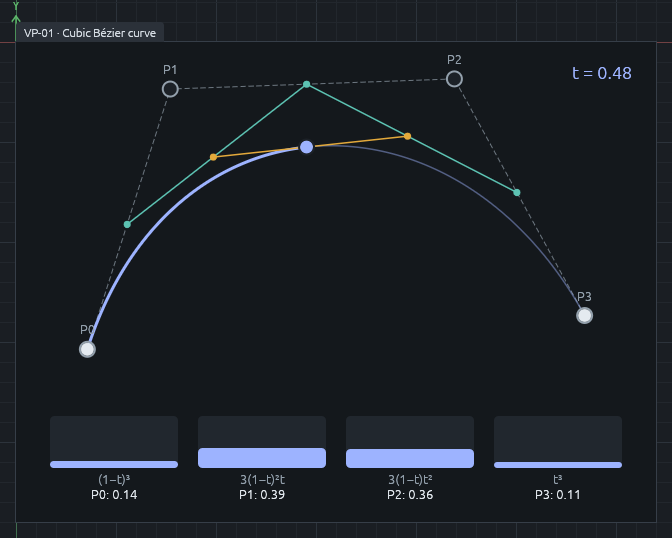</a><br><b>Cubic Bézier curve</b> <code>BEZ</code><br><code>B(t) = (1−t)³P0 + 3(1−t)²t P1 + 3(1−t)t² P2 + t³P3</code><br><sub>Drag the control points; see de Casteljau&#x27;s lerps of lerps and the Bernstein weights.</sub><br><sub><a href="assets/content/cubic-bezier/doc.md">Docs</a> · <a href="assets/content/cubic-bezier/main.py">Python</a> · <a href="assets/content/cubic-bezier/main.ts">TypeScript</a> · <a href="assets/content/cubic-bezier/main.rs">Rust</a></sub></td>
<td width="33%" valign="top"><a href="assets/content/fourier-epicycles/doc.md"></a><br><b>Drawn by circles</b> <code>FOU</code><br><code>z(t) = Σ c_k e^(ikt)</code><br><sub>Pick one of 64 animals; slide the number of circles down and watch the details melt away.</sub><br><sub><a href="assets/content/fourier-epicycles/doc.md">Docs</a> · <a href="assets/content/fourier-epicycles/main.py">Python</a> · <a href="assets/content/fourier-epicycles/main.ts">TypeScript</a> · <a href="assets/content/fourier-epicycles/main.rs">Rust</a></sub></td>
</tr>
<tr>
<td width="33%" valign="top"><a href="assets/content/lissajous/doc.md">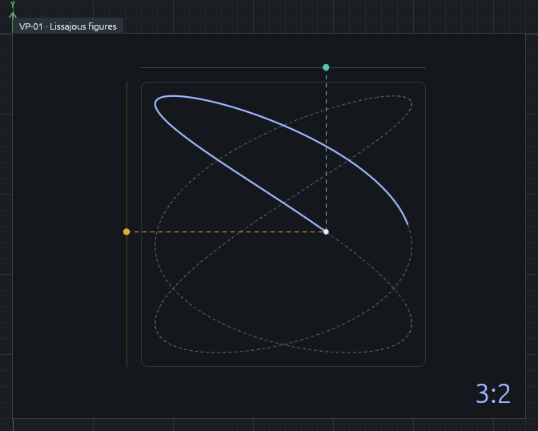</a><br><b>Lissajous figures</b> <code>LIS</code><br><code>x = A sin(at + δπ), y = B sin(bt)</code><br><sub>Set amplitudes, frequencies and phase; δ drifts so the figure morphs and seems to turn in 3D.</sub><br><sub><a href="assets/content/lissajous/doc.md">Docs</a> · <a href="assets/content/lissajous/main.py">Python</a> · <a href="assets/content/lissajous/main.ts">TypeScript</a> · <a href="assets/content/lissajous/main.rs">Rust</a></sub></td>
<td width="33%" valign="top"><a href="assets/content/expression/doc.md">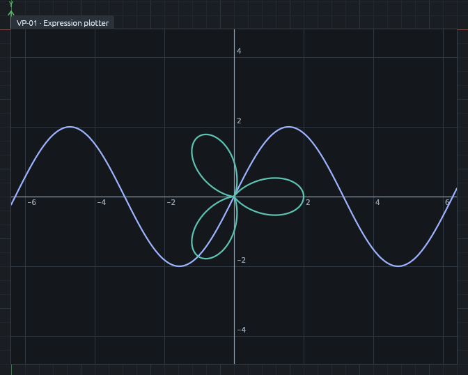</a><br><b>Expression plotter</b> <code>EXP</code><br><code>y = a sin(bx) · r = 1 + cos(3θ) · (cos t, sin t)</code><br><sub>Type up to six rows; every free letter gets a slider. Drag to pan, scroll to zoom; the code export contains your expressions.</sub><br><sub><a href="assets/content/expression/doc.md">Docs</a> · <a href="assets/content/expression/main.py">Python</a> · <a href="assets/content/expression/main.ts">TypeScript</a> · <a href="assets/content/expression/main.rs">Rust</a></sub></td>
<td width="33%"></td>
</tr>
</table>

### Physics & Network Layouts

<table>
<tr>
<td width="33%" valign="top"><a href="assets/content/force-layout/doc.md">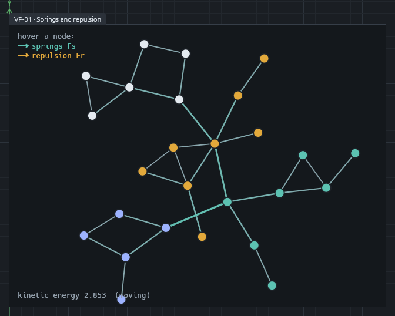</a><br><b>Springs and repulsion</b> <code>FRC</code><br><code>Fs = −k(d − x0), Fr = kr/d²</code><br><sub>Drag a node and watch the graph rebalance; hover a node for its force arrows.</sub><br><sub><a href="assets/content/force-layout/doc.md">Docs</a> · <a href="assets/content/force-layout/main.py">Python</a> · <a href="assets/content/force-layout/main.ts">TypeScript</a> · <a href="assets/content/force-layout/main.rs">Rust</a></sub></td>
</tr>
</table>

### Data Scaling & Normalization

<table>
<tr>
<td width="33%" valign="top"><a href="assets/content/min-max-normalization/doc.md">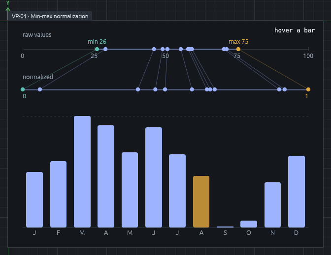</a><br><b>Min-max normalization</b> <code>NRM</code><br><code>x&#x27; = (x − min) / (max − min)</code><br><sub>Push the outlier up and watch every other bar get squashed; hover a bar for its calculation.</sub><br><sub><a href="assets/content/min-max-normalization/doc.md">Docs</a> · <a href="assets/content/min-max-normalization/main.py">Python</a> · <a href="assets/content/min-max-normalization/main.ts">TypeScript</a> · <a href="assets/content/min-max-normalization/main.rs">Rust</a></sub></td>
</tr>
</table>

### Fractals & Generative Patterns

<table>
<tr>
<td width="33%" valign="top"><a href="assets/content/mandelbrot/doc.md">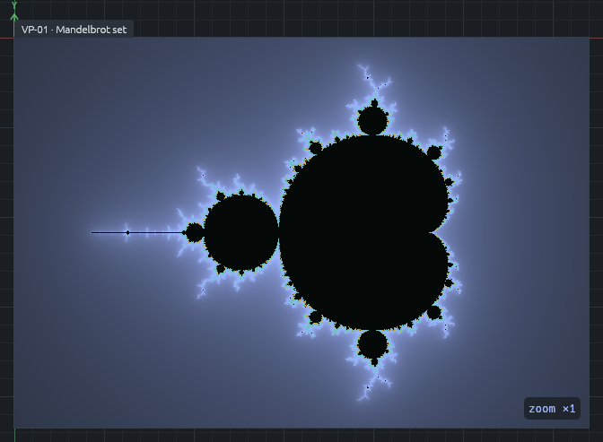</a><br><b>Mandelbrot set</b> <code>MAN</code><br><code>z(n+1) = z(n)² + c</code><br><sub>Click to zoom in, right-click to zoom out, drag to pan; hover to see a point&#x27;s orbit.</sub><br><sub><a href="assets/content/mandelbrot/doc.md">Docs</a> · <a href="assets/content/mandelbrot/main.py">Python</a> · <a href="assets/content/mandelbrot/main.ts">TypeScript</a> · <a href="assets/content/mandelbrot/main.rs">Rust</a></sub></td>
<td width="33%" valign="top"><a href="assets/content/flow-field/doc.md">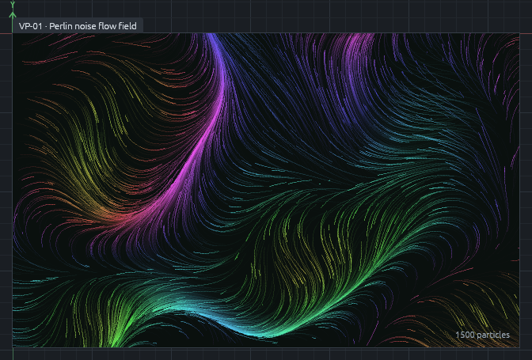</a><br><b>Perlin noise flow field</b> <code>FLW</code><br><code>θ = N(x, y, t) · 2π · k</code><br><sub>Particles with fading trails follow the noise; hover to read the field, or show the vectors.</sub><br><sub><a href="assets/content/flow-field/doc.md">Docs</a> · <a href="assets/content/flow-field/main.py">Python</a> · <a href="assets/content/flow-field/main.ts">TypeScript</a> · <a href="assets/content/flow-field/main.rs">Rust</a></sub></td>
<td width="33%" valign="top"><a href="assets/content/game-of-life/doc.md"></a><br><b>Conway&#x27;s Game of Life</b> <code>LIF</code><br><code>born with 3 neighbours, survives with 2 or 3</code><br><sub>Draw and erase cells, load classic patterns, hover a cell to see the rule at work.</sub><br><sub><a href="assets/content/game-of-life/doc.md">Docs</a> · <a href="assets/content/game-of-life/main.py">Python</a> · <a href="assets/content/game-of-life/main.ts">TypeScript</a> · <a href="assets/content/game-of-life/main.rs">Rust</a></sub></td>
</tr>
</table>

### Chaos & Dynamical Systems

<table>
<tr>
<td width="33%" valign="top"><a href="assets/content/lorenz/doc.md"></a><br><b>Lorenz attractor</b> <code>LOR</code><br><code>dx/dt = σ(y − x), dy/dt = x(ρ − z) − y, dz/dt = xy − βz</code><br><sub>Drag to orbit; tune σ, ρ, β; follow up to three nearly identical starts as they part.</sub><br><sub><a href="assets/content/lorenz/doc.md">Docs</a> · <a href="assets/content/lorenz/main.py">Python</a> · <a href="assets/content/lorenz/main.ts">TypeScript</a> · <a href="assets/content/lorenz/main.rs">Rust</a></sub></td>
</tr>
</table>

### Geometry & Spatial Analysis

<table>
<tr>
<td width="33%" valign="top"><a href="assets/content/euclidean-distance/doc.md">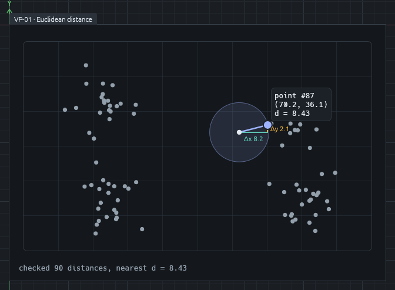</a><br><b>Euclidean distance</b> <code>DST</code><br><code>d = √((x2 − x1)² + (y2 − y1)²)</code><br><sub>Move the mouse to find the nearest point, or switch to K-means and watch clusters form.</sub><br><sub><a href="assets/content/euclidean-distance/doc.md">Docs</a> · <a href="assets/content/euclidean-distance/main.py">Python</a> · <a href="assets/content/euclidean-distance/main.ts">TypeScript</a> · <a href="assets/content/euclidean-distance/main.rs">Rust</a></sub></td>
<td width="33%" valign="top"><a href="assets/content/rotation-matrix/doc.md">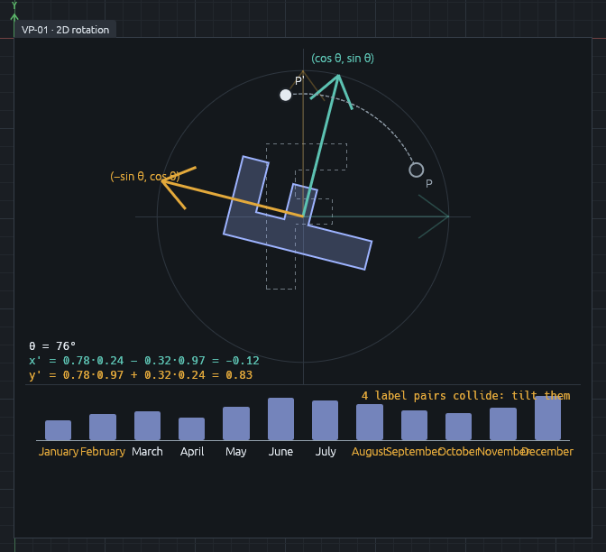</a><br><b>2D rotation</b> <code>ROT</code><br><code>x&#x27; = x cos θ − y sin θ, y&#x27; = x sin θ + y cos θ</code><br><sub>Drag the point; tilt the crowded month labels until they stop colliding.</sub><br><sub><a href="assets/content/rotation-matrix/doc.md">Docs</a> · <a href="assets/content/rotation-matrix/main.py">Python</a> · <a href="assets/content/rotation-matrix/main.ts">TypeScript</a> · <a href="assets/content/rotation-matrix/main.rs">Rust</a></sub></td>
<td width="33%" valign="top"><a href="assets/content/voronoi/doc.md">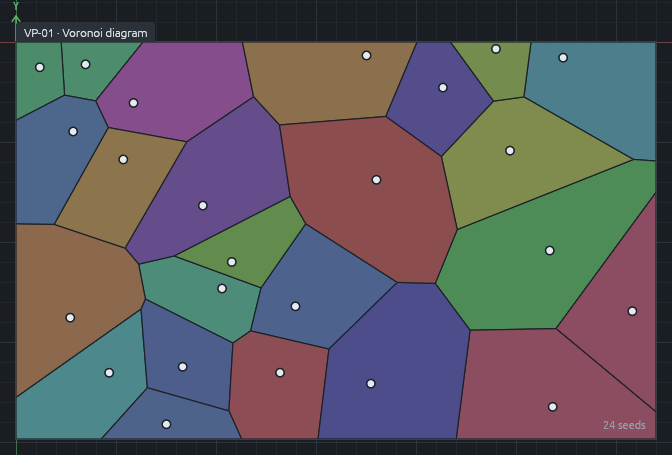</a><br><b>Voronoi diagram</b> <code>VOR</code><br><code>V(pᵢ) = {x : d(x, pᵢ) ≤ d(x, pⱼ) for all j ≠ i}</code><br><sub>Drag, add and remove seeds; Lloyd relaxation, Delaunay edges, giraffe, cracked-mud and dragonfly-wing styles.</sub><br><sub><a href="assets/content/voronoi/doc.md">Docs</a> · <a href="assets/content/voronoi/main.py">Python</a> · <a href="assets/content/voronoi/main.ts">TypeScript</a> · <a href="assets/content/voronoi/main.rs">Rust</a></sub></td>
</tr>
</table>

### Linear Algebra

<table>
<tr>
<td width="33%" valign="top"><a href="assets/content/matrix-transform/doc.md">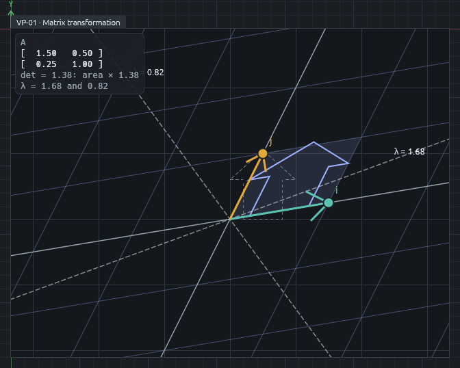</a><br><b>Matrix transformation</b> <code>MAT</code><br><code>x&#x27; = a x + b y, y&#x27; = c x + d y</code><br><sub>Drag the basis tips and the grid warps; det shading, eigenvectors, presets, and a chain of up to three matrices.</sub><br><sub><a href="assets/content/matrix-transform/doc.md">Docs</a> · <a href="assets/content/matrix-transform/main.py">Python</a> · <a href="assets/content/matrix-transform/main.ts">TypeScript</a> · <a href="assets/content/matrix-transform/main.rs">Rust</a></sub></td>
</tr>
</table>

### Statistics & Trend Analysis

<table>
<tr>
<td width="33%" valign="top"><a href="assets/content/linear-regression/doc.md">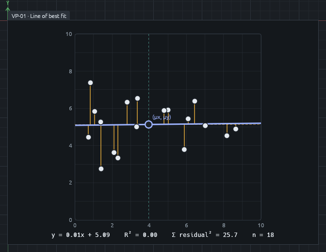</a><br><b>Line of best fit</b> <code>REG</code><br><code>minimize Σ (yᵢ − (m xᵢ + b))²</code><br><sub>Drag points, click to add, right-click to remove; residuals, squared errors and R².</sub><br><sub><a href="assets/content/linear-regression/doc.md">Docs</a> · <a href="assets/content/linear-regression/main.py">Python</a> · <a href="assets/content/linear-regression/main.ts">TypeScript</a> · <a href="assets/content/linear-regression/main.rs">Rust</a></sub></td>
</tr>
</table>

### Animation & Easing

<table>
<tr>
<td width="33%" valign="top"><a href="assets/content/ease-out-cubic/doc.md">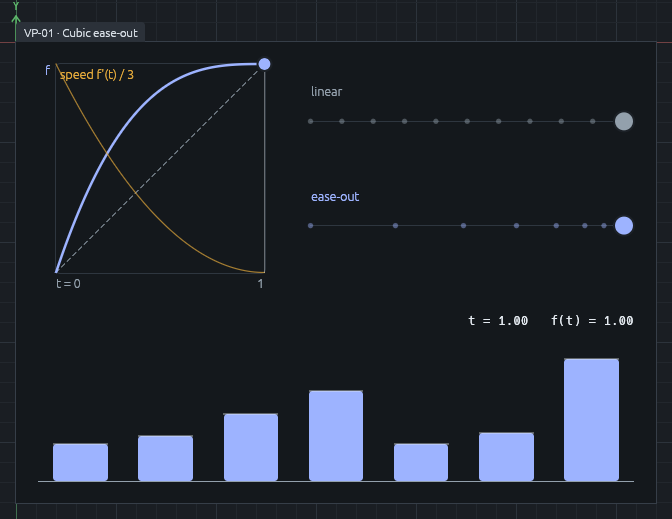</a><br><b>Cubic ease-out</b> <code>EAS</code><br><code>f(t) = 1 − (1 − t)³</code><br><sub>The curve and its speed, a linear vs eased race, and bars gliding into place.</sub><br><sub><a href="assets/content/ease-out-cubic/doc.md">Docs</a> · <a href="assets/content/ease-out-cubic/main.py">Python</a> · <a href="assets/content/ease-out-cubic/main.ts">TypeScript</a> · <a href="assets/content/ease-out-cubic/main.rs">Rust</a></sub></td>
</tr>
</table>

### Color & Accessibility

<table>
<tr>
<td width="33%" valign="top"><a href="assets/content/relative-luminance/doc.md">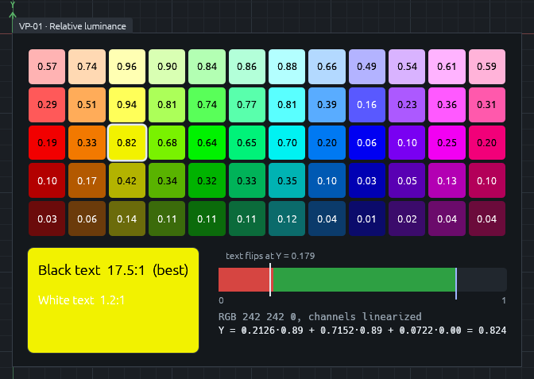</a><br><b>Relative luminance</b> <code>LUM</code><br><code>Y = 0.2126R + 0.7152G + 0.0722B</code><br><sub>The heatmap picks black or white text for each cell; contrast ratios; WCAG linearization.</sub><br><sub><a href="assets/content/relative-luminance/doc.md">Docs</a> · <a href="assets/content/relative-luminance/main.py">Python</a> · <a href="assets/content/relative-luminance/main.ts">TypeScript</a> · <a href="assets/content/relative-luminance/main.rs">Rust</a></sub></td>
</tr>
</table>

### Sorting

All sorting viewports share one list (random, nearly sorted, reversed or few unique). Play, pause, step, step back and scrub through every comparison, swap and write; four skins; sound.

<table>
<tr>
<td width="33%" valign="top"><a href="assets/content/bubble-sort/doc.md">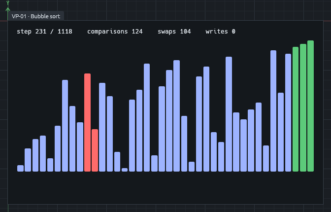</a><br><b>Bubble sort</b> <code>BUB</code><br><code>O(n²), O(n) best</code><br><sub>Neighbours swap until each pass carries the largest value to the end.</sub><br><sub><a href="assets/content/bubble-sort/doc.md">Docs</a> · <a href="assets/content/bubble-sort/main.py">Python</a> · <a href="assets/content/bubble-sort/main.ts">TypeScript</a> · <a href="assets/content/bubble-sort/main.rs">Rust</a></sub></td>
<td width="33%" valign="top"><a href="assets/content/selection-sort/doc.md">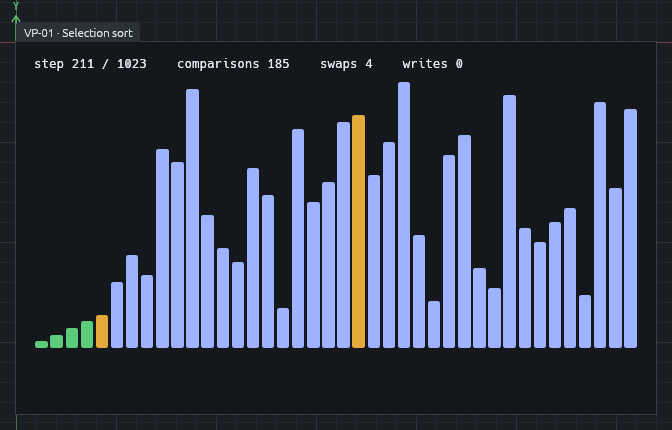</a><br><b>Selection sort</b> <code>SEL</code><br><code>O(n²) always, at most n − 1 swaps</code><br><sub>The smallest unsorted value (purple) is swapped to the front.</sub><br><sub><a href="assets/content/selection-sort/doc.md">Docs</a> · <a href="assets/content/selection-sort/main.py">Python</a> · <a href="assets/content/selection-sort/main.ts">TypeScript</a> · <a href="assets/content/selection-sort/main.rs">Rust</a></sub></td>
<td width="33%" valign="top"><a href="assets/content/insertion-sort/doc.md">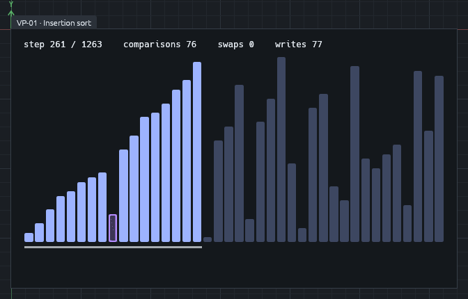</a><br><b>Insertion sort</b> <code>INS</code><br><code>O(n²), O(n) best</code><br><sub>Each key slides left into place; try the Nearly sorted preset.</sub><br><sub><a href="assets/content/insertion-sort/doc.md">Docs</a> · <a href="assets/content/insertion-sort/main.py">Python</a> · <a href="assets/content/insertion-sort/main.ts">TypeScript</a> · <a href="assets/content/insertion-sort/main.rs">Rust</a></sub></td>
</tr>
<tr>
<td width="33%" valign="top"><a href="assets/content/merge-sort/doc.md">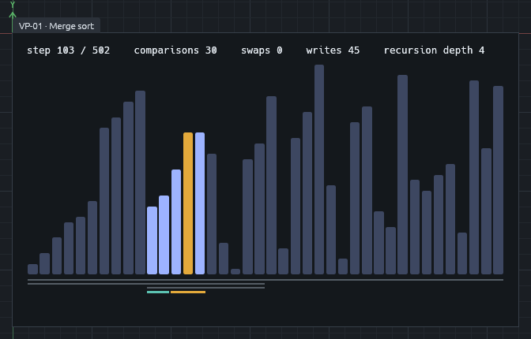</a><br><b>Merge sort</b> <code>MRG</code><br><code>O(n log n), O(n) space</code><br><sub>Split into halves, then merge them back; brackets show the recursion.</sub><br><sub><a href="assets/content/merge-sort/doc.md">Docs</a> · <a href="assets/content/merge-sort/main.py">Python</a> · <a href="assets/content/merge-sort/main.ts">TypeScript</a> · <a href="assets/content/merge-sort/main.rs">Rust</a></sub></td>
<td width="33%" valign="top"><a href="assets/content/quick-sort/doc.md">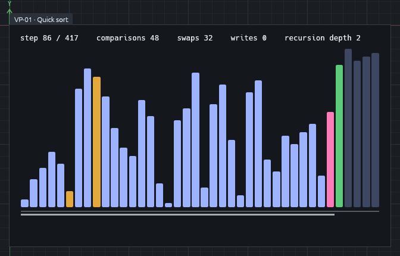</a><br><b>Quick sort</b> <code>QCK</code><br><code>O(n log n) average, O(n²) worst</code><br><sub>Partition around the pivot (pink), then sort each side.</sub><br><sub><a href="assets/content/quick-sort/doc.md">Docs</a> · <a href="assets/content/quick-sort/main.py">Python</a> · <a href="assets/content/quick-sort/main.ts">TypeScript</a> · <a href="assets/content/quick-sort/main.rs">Rust</a></sub></td>
<td width="33%" valign="top"><a href="assets/content/quick-sort-3way/doc.md">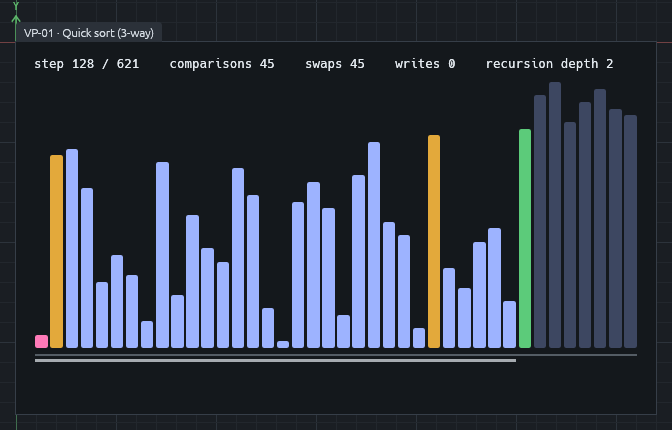</a><br><b>Quick sort (3-way)</b> <code>Q3W</code><br><code>O(n log n), fast with repeated keys</code><br><sub>Keys equal to the pivot gather in the middle; try Few unique.</sub><br><sub><a href="assets/content/quick-sort-3way/doc.md">Docs</a> · <a href="assets/content/quick-sort-3way/main.py">Python</a> · <a href="assets/content/quick-sort-3way/main.ts">TypeScript</a> · <a href="assets/content/quick-sort-3way/main.rs">Rust</a></sub></td>
</tr>
<tr>
<td width="33%" valign="top"><a href="assets/content/heap-sort/doc.md">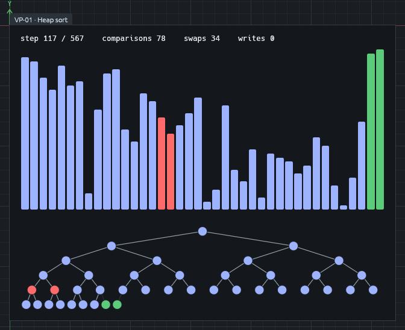</a><br><b>Heap sort</b> <code>HEP</code><br><code>O(n log n), O(1) space</code><br><sub>The list drawn as a heap: build it, then pull out the largest each time.</sub><br><sub><a href="assets/content/heap-sort/doc.md">Docs</a> · <a href="assets/content/heap-sort/main.py">Python</a> · <a href="assets/content/heap-sort/main.ts">TypeScript</a> · <a href="assets/content/heap-sort/main.rs">Rust</a></sub></td>
<td width="33%" valign="top"><a href="assets/content/counting-sort/doc.md">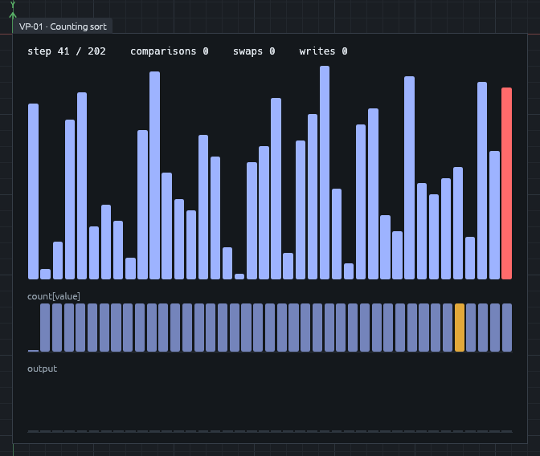</a><br><b>Counting sort</b> <code>CNT</code><br><code>O(n + k)</code><br><sub>Tally every value, then write the output straight from the counts.</sub><br><sub><a href="assets/content/counting-sort/doc.md">Docs</a> · <a href="assets/content/counting-sort/main.py">Python</a> · <a href="assets/content/counting-sort/main.ts">TypeScript</a> · <a href="assets/content/counting-sort/main.rs">Rust</a></sub></td>
<td width="33%" valign="top"><a href="assets/content/sorting-race/doc.md"></a><br><b>Sorting race</b> <code>RCE</code><br><code>same list, same steps per second</code><br><sub>Race the algorithms you pick, with live comparisons, moves and a measured time.</sub><br><sub><a href="assets/content/sorting-race/doc.md">Docs</a> · <a href="assets/content/sorting-race/main.py">Python</a> · <a href="assets/content/sorting-race/main.ts">TypeScript</a> · <a href="assets/content/sorting-race/main.rs">Rust</a></sub></td>
</tr>
</table>

### Graphs & Trees

The searches share one grid: draw walls and mud, drag the start and goal, make a maze. Every run can be played, stepped and scrubbed.

<table>
<tr>
<td width="33%" valign="top"><a href="assets/content/bfs/doc.md"></a><br><b>Breadth-first search</b> <code>BFS</code><br><code>dist(n) = dist(u) + 1</code><br><sub>Explores in rings of equal distance, so its first path is the shortest in steps.</sub><br><sub><a href="assets/content/bfs/doc.md">Docs</a> · <a href="assets/content/bfs/main.py">Python</a> · <a href="assets/content/bfs/main.ts">TypeScript</a> · <a href="assets/content/bfs/main.rs">Rust</a></sub></td>
<td width="33%" valign="top"><a href="assets/content/dfs/doc.md">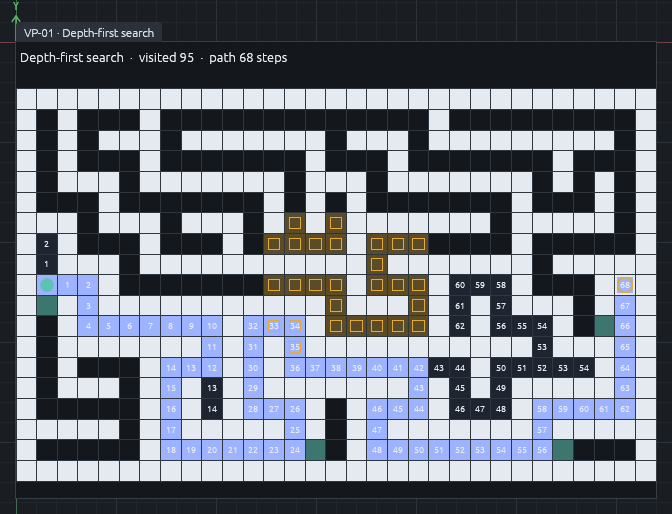</a><br><b>Depth-first search</b> <code>DFS</code><br><code>newest frontier cell first (a stack)</code><br><sub>Dives down one corridor before backing up; finds a path, rarely the shortest.</sub><br><sub><a href="assets/content/dfs/doc.md">Docs</a> · <a href="assets/content/dfs/main.py">Python</a> · <a href="assets/content/dfs/main.ts">TypeScript</a> · <a href="assets/content/dfs/main.rs">Rust</a></sub></td>
<td width="33%" valign="top"><a href="assets/content/dijkstra/doc.md">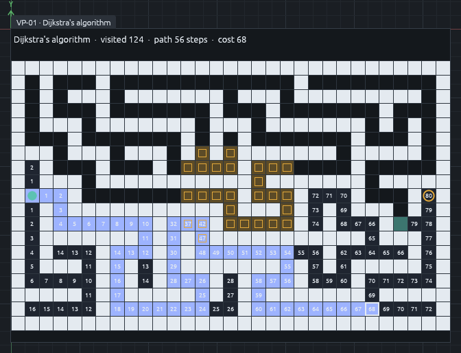</a><br><b>Dijkstra&#x27;s algorithm</b> <code>DIJ</code><br><code>dist(n) = min(dist(n), dist(u) + w(n))</code><br><sub>Settles cells by total cost, so it walks around mud when a detour is cheaper.</sub><br><sub><a href="assets/content/dijkstra/doc.md">Docs</a> · <a href="assets/content/dijkstra/main.py">Python</a> · <a href="assets/content/dijkstra/main.ts">TypeScript</a> · <a href="assets/content/dijkstra/main.rs">Rust</a></sub></td>
</tr>
<tr>
<td width="33%" valign="top"><a href="assets/content/a-star/doc.md"></a><br><b>A* search</b> <code>AST</code><br><code>f(n) = g(n) + h(n)</code><br><sub>Dijkstra steered by a straight-line guess of the distance left; visits fewer cells.</sub><br><sub><a href="assets/content/a-star/doc.md">Docs</a> · <a href="assets/content/a-star/main.py">Python</a> · <a href="assets/content/a-star/main.ts">TypeScript</a> · <a href="assets/content/a-star/main.rs">Rust</a></sub></td>
<td width="33%" valign="top"><a href="assets/content/binary-search-tree/doc.md">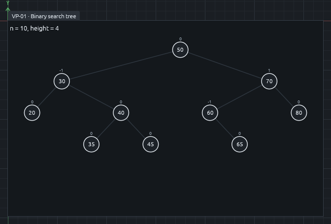</a><br><b>Binary search tree</b> <code>BST</code><br><code>AVL: balance factor within 1</code><br><sub>Insert, delete and find keys; toggle AVL; in-, pre- and post-order walks; rotations glide into place.</sub><br><sub><a href="assets/content/binary-search-tree/doc.md">Docs</a> · <a href="assets/content/binary-search-tree/main.py">Python</a> · <a href="assets/content/binary-search-tree/main.ts">TypeScript</a> · <a href="assets/content/binary-search-tree/main.rs">Rust</a></sub></td>
<td width="33%" valign="top"><a href="assets/content/kruskal/doc.md">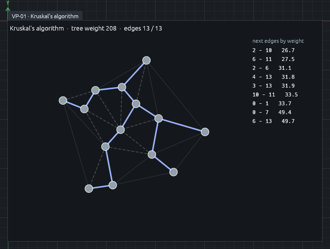</a><br><b>Kruskal&#x27;s algorithm</b> <code>KRU</code><br><code>minimize Σ w(e) over the n − 1 tree edges</code><br><sub>Takes edges by weight, keeping each one that joins two trees; drag the points.</sub><br><sub><a href="assets/content/kruskal/doc.md">Docs</a> · <a href="assets/content/kruskal/main.py">Python</a> · <a href="assets/content/kruskal/main.ts">TypeScript</a> · <a href="assets/content/kruskal/main.rs">Rust</a></sub></td>
</tr>
<tr>
<td width="33%" valign="top"><a href="assets/content/prim/doc.md">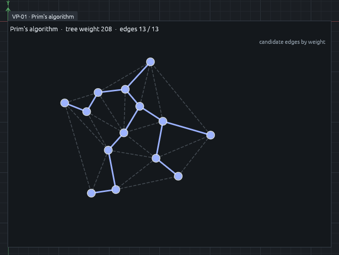</a><br><b>Prim&#x27;s algorithm</b> <code>PRI</code><br><code>minimize Σ w(e) over the n − 1 tree edges</code><br><sub>Grows one tree from a vertex, always by the lightest edge leaving it.</sub><br><sub><a href="assets/content/prim/doc.md">Docs</a> · <a href="assets/content/prim/main.py">Python</a> · <a href="assets/content/prim/main.ts">TypeScript</a> · <a href="assets/content/prim/main.rs">Rust</a></sub></td>
<td width="33%"></td>
<td width="33%"></td>
</tr>
</table>

### Proofs & Derivations

<table>
<tr>
<td width="33%" valign="top"><a href="assets/content/quadratic-formula/doc.md">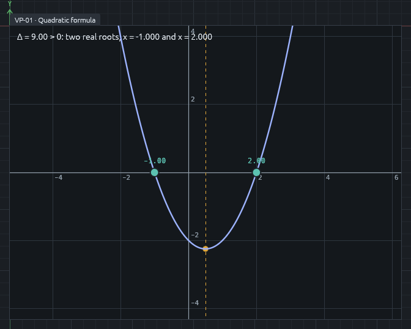</a><br><b>Quadratic formula</b> <code>QDR</code><br><code>x = (−b ± √(b² − 4ac)) / 2a</code><br><sub>Slide a, b and c; roots, vertex and axis; the Derive tab completes the square.</sub><br><sub><a href="assets/content/quadratic-formula/doc.md">Docs</a> · <a href="assets/content/quadratic-formula/main.py">Python</a> · <a href="assets/content/quadratic-formula/main.ts">TypeScript</a> · <a href="assets/content/quadratic-formula/main.rs">Rust</a></sub></td>
<td width="33%" valign="top"><a href="assets/content/pythagorean-proof/doc.md"></a><br><b>Pythagorean theorem</b> <code>PYT</code><br><code>a² + b² = c²</code><br><sub>Four triangles slide around an (a + b)² square, or the altitude splits it into two copies.</sub><br><sub><a href="assets/content/pythagorean-proof/doc.md">Docs</a> · <a href="assets/content/pythagorean-proof/main.py">Python</a> · <a href="assets/content/pythagorean-proof/main.ts">TypeScript</a> · <a href="assets/content/pythagorean-proof/main.rs">Rust</a></sub></td>
<td width="33%" valign="top"><a href="assets/content/euler-identity/doc.md">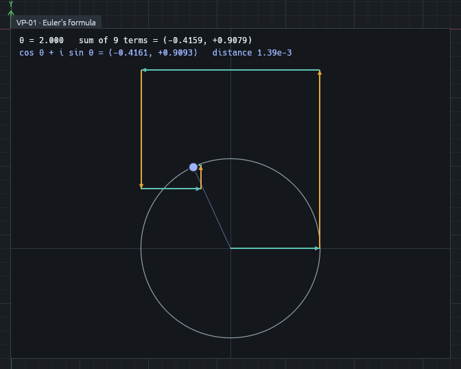</a><br><b>Euler&#x27;s formula</b> <code>EUL</code><br><code>e^(iθ) = cos θ + i sin θ</code><br><sub>The Taylor series as arrows spiralling onto the unit circle; θ = π gives e^(iπ) + 1 = 0.</sub><br><sub><a href="assets/content/euler-identity/doc.md">Docs</a> · <a href="assets/content/euler-identity/main.py">Python</a> · <a href="assets/content/euler-identity/main.ts">TypeScript</a> · <a href="assets/content/euler-identity/main.rs">Rust</a></sub></td>
</tr>
</table>

## The workbench

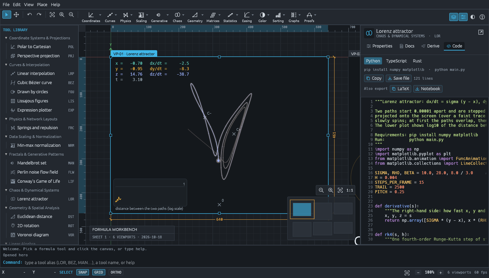

| Area | What it does |
| --- | --- |
| Toolbar | Select (V) and Pan (H), undo/redo, zoom; one button per category with a menu of its tools |
| Browser (left) | Tool library (click to place, double-click to place beside the drawing) and the list of viewports with show/hide and lock |
| Canvas | Infinite drafting plane with an adaptive grid, origin axes, rulers, crosshair, navigator (with zoom, fit and 1:1 buttons) and title block |
| Inspector (right) | **Properties**: name, X/Y/W/H, lock, the equations and the formula's controls. **Docs**: the full reference. **Derive**: the formula explained step by step: Prev / Next reveal one step at a time, "Plug in current values" works the equations out with the viewport's numbers one operation per step (distance, lerp, polar, rotation, luminance, normalization, easing and the proof tools), and authored derivations explain where the equations come from. **Code**: Python, TypeScript and Rust, with Copy and Download (Save on desktop), plus **LaTeX** (the equations with the viewport's current values) and a Jupyter **Notebook** (`.ipynb`). The maximize button widens it for reading |
| Command line | Type a tool alias (`LOR`, `BEZ`, `MAN`, `VOR`, …) or name to place it, or a command: `fit`, `zoom 150`, `del`, `dup`, `undo`, `redo`, `grid`, `snap`, `ortho`, `latex` (copy the selection's equations as LaTeX), `ipynb` (export it as a notebook), `plot <expression>` (place an expression plotter, e.g. `plot r = 1 + cos(3θ)`), `derive` (open the Derive tab), `open [file]` and `save [name]` (sheet files), `help` |
| Status bar | Pointer coordinates, current tool, SNAP / GRID / ORTHO toggles, zoom, viewport count, fps |

Working with viewports:

- **Select** a viewport by clicking it or its title tab; Shift adds to the selection. Drag on empty
  canvas for a window selection (left to right: fully inside) or crossing selection (right to left:
  touching).
- **Use** the selected (active) viewport: dragging inside it goes to the formula, so you can move
  Bézier control points, draw Life cells or orbit the Lorenz attractor.
- **Move** by dragging the title tab, or an inactive viewport. Moves snap to the grid and to the
  edges and centers of other viewports, with dashed guides; ORTHO (or Shift) keeps a move on one axis.
- **Resize** with the eight grips; Shift keeps the aspect ratio. A viewport cannot shrink below the
  size its formula needs. The selected viewport shows its width and height as dimension lines.
- **Navigate** with the wheel (zoom about the pointer), pinch, middle-drag or Shift+wheel (pan),
  F (fit all), Shift+F (fit selection), Ctrl+0 (100%), or by clicking the navigator.
- **Edit** with Ctrl+Z / Ctrl+Y, Ctrl+D (duplicate), Del, arrow keys (nudge; Shift for ×10), and
  right-click menus on viewports and the canvas.

Formulas are drawn at their natural size (one world unit is one point) on a layer that egui scales
and translates as a whole, so every formula keeps its own layout at any zoom, and lines stay crisp.
The layout, every formula's settings, the camera, theme and settings are saved between sessions.

### Sorting visualizer

Sorting viewports share one list per sheet, so a shuffle in one shows up in every other and
algorithms can be compared on the same input. Each algorithm runs once on the shared list inside a
`Recorder` that logs every operation (`Compare`, `Swap`, `Write`, `Sorted`, pivot/minimum/key
markers, recursion `Enter`/`Exit`, and counting sort's tallies). The viewport replays that log at
the chosen speed, and seeking backwards replays from the start, so you can scrub through a run like
a video. Bars use one color language: blue unsorted, red comparing, amber swapping or writing, green
in final place, plus purple for selection's minimum or insertion's key and pink for quick sort's
pivot. Heap sort draws the heap as a tree for lists of up to 63 values; counting sort shows its
tally histogram and output array.

- **Skins**: bars, radial (a clock face; swaps sweep a curve across it), color spectrum (value as
  hue, so an unsorted list is a jumbled rainbow that settles into a gradient) and dot scatter.
- **Sound**: each step plays the touched value as a pitch, `frequency = 150 + X_norm · 650` Hz, and
  a finished run ends with a rising sweep. The browser build uses the Web Audio API; the desktop
  build uses `cpal` when built with `--features native-audio`.
- **Keys**: while a sorting viewport is selected, Space plays or pauses and the Left and Right
  arrows step back and forward.
- **Presets**: Nearly sorted has just two or three values out of place, which is where insertion
  sort shines; Few unique is where 3-way quick sort leaves the 2-way version behind.

The **Sorting race** runs the chosen algorithms on the same list at the same steps per second, so
fewer operations means an earlier finish. Each lane shows comparisons and swaps + writes live, and,
once it finishes, a measured time from actually running that algorithm (without recording) on this
machine.

## Sheet files

A sheet (`.fwb`) saves the whole board in a plain-text file you can keep, share or edit by hand:
the viewports with every formula's settings (sliders, toggles, dragged points, painted Life cells),
the data viewports share (the sorting list, the pathfinding grid, the MST graph), the camera, the
canvas settings and the panels.

- **File menu:** New sheet, Open... (Ctrl+O), Save (Ctrl+S), Save As... (Ctrl+Shift+S), Recent (the
  last eight, desktop only) and Examples (Linear algebra basics, Sorting showdown, Pathfinding lab).
- **Command line:** `open path/to/lesson.fwb`, `open` (shows the dialog), `save` (to the current
  file, else `exports/sheets/untitled.fwb`) and `save lesson` (to `exports/sheets/lesson.fwb`).
- **Drag and drop** a `.fwb` file onto the window to open it.
- In the browser, Save downloads the sheet, and Save As first asks for a file name.

Opening a sheet replaces the board and can be undone in one step. A sheet keeps its saved view,
unless that view would leave viewports off screen (say, a sheet saved on a larger monitor); then
it zooms to fit. Duplicate (Ctrl+D) copies a viewport together with its settings. The title bar
shows the file name, with a dot (•) while there are unsaved changes. Panning, zooming and switching
tabs don't count as changes, and neither does a running animation. A sheet from a newer version of
the app, or a damaged file, is refused with the line number and the board is kept. Unknown tools,
sections, keys and parameters are skipped and listed in the command log.

```text
FWB 1
; Formula Workbench sheet

SECTION HEADER
  app 0.1.0
  title "Sorting showdown"
ENDSEC

SECTION CAMERA
  center 680.0 479.0
  zoom 0.79
ENDSEC

SECTION SHARED
  sorting {"dist":"nearly_sorted","n":60,"seed":3,"skin":"bars"}
ENDSEC

SECTION VIEWPORT
  uid 1
  tool bubble-sort
  title VP-01
  rect 0.0 0.0 640.0 372.0
  locked false
  hidden false
  param speed 80
ENDSEC
```

Each line is a key and a value. A value is JSON, except that a list of numbers is written with
spaces (`rect 0 0 640 480`) and a simple word needs no quotes (`tool lerp`). `param` lines are the
formula's settings (its `save_state`). Missing keys keep their defaults; SETTINGS and UI sections
work the same way (`theme dark`, `tab docs`, `grid false`).

## Run

Native:

```sh
cargo run --release
# with sound on the sorting viewports (Linux needs the ALSA headers: libasound2-dev)
cargo run --release --features native-audio
```

On Linux you need the usual windowing libraries (`libxkbcommon-x11`, an OpenGL driver).

Web:

```sh
rustup target add wasm32-unknown-unknown
cargo install wasm-bindgen-cli --version 0.2.129   # must match the wasm-bindgen version in Cargo.lock
cargo build --release --lib --target wasm32-unknown-unknown
wasm-bindgen --target web --no-typescript --out-dir pkg target/wasm32-unknown-unknown/release/formula.wasm
python3 -m http.server   # then open http://localhost:8000 (or http://localhost:8000/#lorenz)
```

The example programs in `assets/content/<id>/` (the same code as the Inspector's Code tab) run on
their own:

```sh
pip install numpy matplotlib && python main.py              # Python
tsc main.ts                                                 # TypeScript: load main.js in any page
cargo new demo && cd demo && cargo add macroquad@0.4        # Rust: replace src/main.rs, then
cargo run --release
```

## Develop

```sh
cargo test                                   # every test (fast)
cargo fmt --check
cargo clippy --all-targets -- -D warnings
```

### Layout

```text
src/
  main.rs            native entry point
  web.rs             browser entry point and #id deep links
  app.rs             shell: wires the panels and the canvas together; saves the workspace, sets the title
  content.rs         embedded reference docs and code (table generated by build.rs)
  cad/               the workbench
    canvas.rs        layers, input routing, placing / selecting / moving / resizing, commands
    camera.rs        pan and zoom with smoothing, fit, grid steps (UI-free)
    board.rs         viewports, z-order, selection, smart guides, saved layout (UI-free)
    history.rs       undo / redo
    overlay.rs       grid, rulers, frames, grips, dimensions, guides, crosshair, navigator
    chrome.rs        menu bar, toolbar, Browser, command line, status bar, help
    inspector.rs     Properties, Docs, Derive and Code tabs
    markdown.rs      the docs renderer      highlight.rs  syntax highlighting
    icons.rs         line-art tool and UI icons   theme.rs  graphite and drafting-paper themes
    export.rs        copy, download (web) and save (desktop)
    notebook.rs      Jupyter notebook export
    fwb.rs           the .fwb text format: sections, entries, values (UI-free)
    sheet.rs         a whole board as a sheet, lenient reading with warnings, examples (UI-free)
    files.rs         current file, unsaved mark, Recent list, file dialogs
  formula.rs         the `Formula` trait, `Palette`, `MathText` equation builder
  latex.rs           equations as LaTeX
  draw.rs            drawing helpers: polygon fill, lerp/gradients, draggable handles
  rng.rs             small seeded random number generator
  state.rs           saving and loading formula settings field by field
  expr/              expression engine (UI-free): lexer, Pratt parser, eval, math and code printers
  derive.rs          derivation steps, and plugging values into an expression one operation at a time
  audio.rs           tones: Web Audio in the browser, cpal on desktop (feature native-audio)
  formulas/
    mod.rs           the tool catalogue (`TOOLS`), category names, glyph-coverage test
    polar.rs  projection.rs  lerp.rs  bezier.rs  lissajous.rs
    force.rs  normalize.rs  mandelbrot.rs  flowfield.rs  life.rs  lorenz.rs
    distance.rs  rotation.rs  voronoi.rs  regression.rs  easing.rs  luminance.rs
    matrix/          matrix transformation
    sorting/         algorithms.rs (records every step, UI-free), data.rs (shared list),
                     skin.rs (bars / radial / spectrum / dots), race.rs, mod.rs (player and view)
    graphs/          pathfinding, binary search tree, minimum spanning trees
    replay.rs        step-through player shared by sorting, pathfinding, MST and the BST
    fourier/         epicycles: math.rs (UI-free), animals.rs, mod.rs (view)
    expression/      plotter: plot.rs (view and sampling, UI-free), export.rs (code generation), mod.rs
    proofs/          quadratic.rs, pythagoras.rs, euler.rs (math in plain functions with tests)
assets/animals.json  animal outlines
assets/content/<id>/ doc.md, main.py, main.ts, main.rs for every tool
assets/sheets/       example sheets (File > Examples)
build.rs             embeds assets/content and assets/sheets
docs/media/          the README's screenshots and GIFs (generated by tools/capture)
tools/capture/       headless rendering library + the binary that renders docs/media (a separate crate)
```

### Adding a formula

1. Create a module under `src/formulas/` and implement `formula::Formula` for its state.
   Required: `id`, `name`, `category`, `summary`, `equations`, `paint` (draws the stage every
   frame) and `controls`.
   Optional: `notes` ("Where it's used"), `details`, `stage_height`, `is_animating`, and
   `stage_sense` + `interact` for dragging or clicking on the stage.
   Optional: `min_size` (the smallest viewport it lays out in), `handle_keys` (keyboard shortcuts
   while it is the active viewport) and `wants_scroll` (keep the mouse wheel for itself).
2. Add a `tool!` line to `TOOLS` in `formulas/mod.rs` with its id, name, category and a
   three-letter command alias. Use one of the category constants, or add a new one; the toolbar
   and library group tools by category automatically.
3. Add `assets/content/<id>/` with `doc.md` (the ten sections listed in `content::SECTIONS`),
   `main.py`, `main.ts` and `main.rs`. `cargo test` checks that every tool has all four.
4. Save the settings: a serde `State` struct with `state()` and `apply()` (clamping every value),
   and `crate::state_hooks!()` in the `impl Formula`. `cargo test` checks that every tool saves its
   state, that it round-trips, and that absurd values are clamped.
5. Regenerate the screenshots (below) and add a card for it to the README's gallery.
   `cargo test` checks that every tool has one.

The workbench takes care of placing, selecting, moving and resizing viewports, the panels,
theming, undo and saving the layout. Each viewport has its own instance of the formula. Use the
`Palette` colors (`x`, `y`, `trace`, `fill`, …) so new formulas match the existing ones in both
light and dark mode. Keep the math in plain functions with unit tests, as every module here does.
egui's bundled font lacks some symbols (′ ∈ → ᵢ ᵣ, combining accents like x̄); `cargo test` fails
if a formula's text uses a character with no glyph.

To add a sorting algorithm, add a variant to `Algorithm`, write it against `Recorder`, and add its
text to `info()` in `sorting/mod.rs`; the tests check every algorithm sorts correctly and leaves no
state behind.

### Regenerating the screenshots

Every picture in this README is rendered headlessly by `tools/capture`, a separate crate that
drives the real workbench with [egui_kittest](https://crates.io/crates/egui_kittest) and wgpu at
a fixed frame time, so each run draws the same frames. It writes a PNG of every tool, the
showcase GIFs, `hero.gif` and `inspector.png` to `docs/media/`. The GIFs need `ffmpeg` on the
PATH.

```sh
cargo run --release --manifest-path tools/capture/Cargo.toml
```

The showcase list, the hero board and how long each tool runs before its picture is taken are at
the top of `tools/capture/src/main.rs`.

## Credits

Silhouettes adapted from [game-icons.net](https://game-icons.net) by Lorc, Delapouite and
contributors, licensed [CC BY 3.0](https://creativecommons.org/licenses/by/3.0/). Outlines were
traced and simplified.
